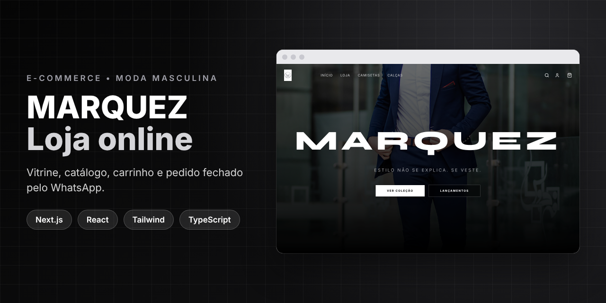
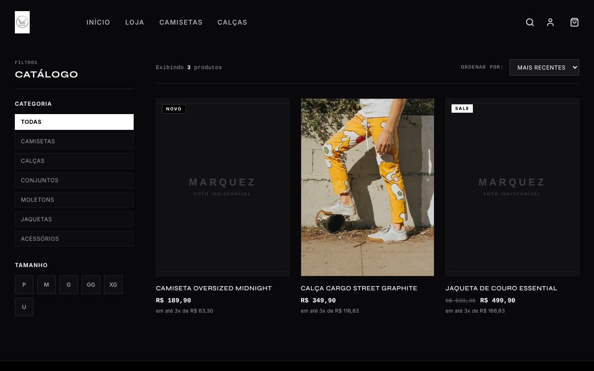
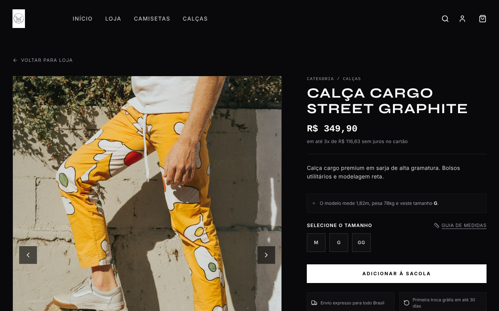
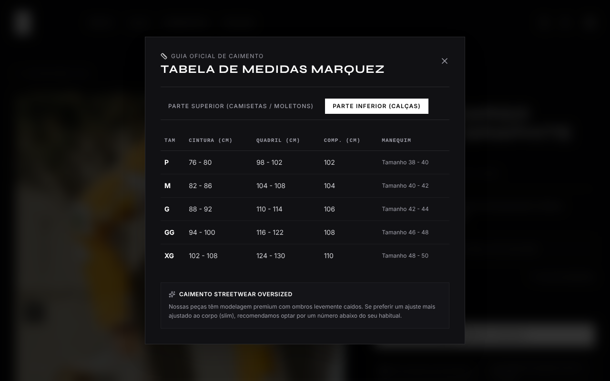
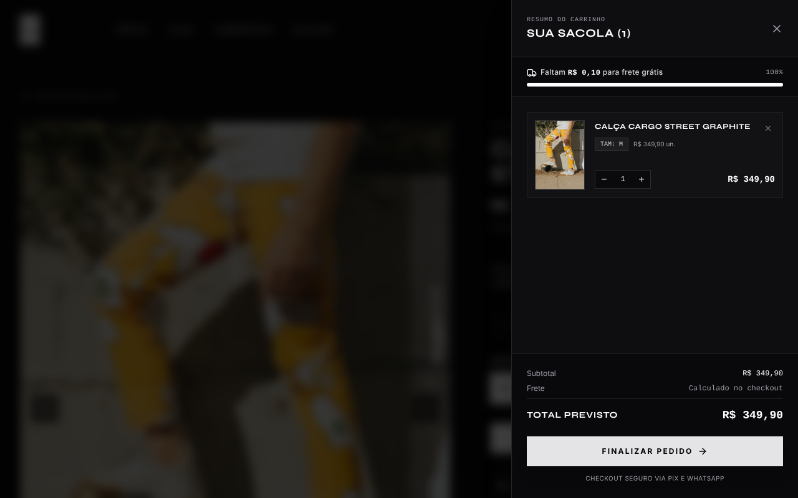
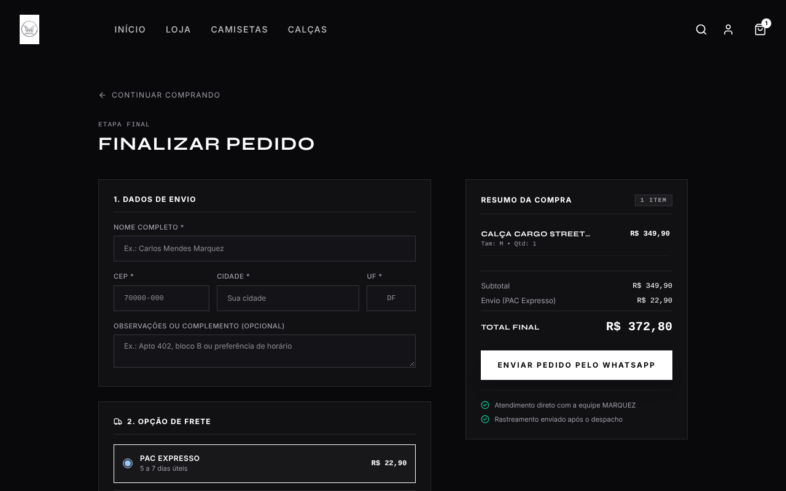

<p align="center">
  
</p>

<h1 align="center">🖤 MARQUEZ — E-commerce de Moda Masculina</h1>

<p align="center">
  Loja online de roupa masculina: vitrine, catálogo por categoria, página de produto com guia de tamanhos,
  carrinho e um checkout que fecha o pedido pelo <b>WhatsApp</b>.
</p>

<p align="center">
  
  
  
  
  
  
</p>

<p align="center">
  <a href="#-sobre-o-projeto">Sobre</a> •
  <a href="#-funcionalidades">Funcionalidades</a> •
  <a href="#-telas">Telas</a> •
  <a href="#-como-executar">Como executar</a> •
  <a href="#-o-catálogo">Catálogo</a> •
  <a href="#-estrutura-do-projeto">Estrutura</a> •
  <a href="#-tecnologias">Tecnologias</a>
</p>

---

## 📌 Sobre o projeto

A **MARQUEZ** é uma loja online de moda masculina com visual escuro e minimalista ("Estilo não se explica. Se
veste."). O cliente navega pelo catálogo, escolhe tamanho, monta a sacola e, no checkout, o pedido é montado e
enviado direto para a conversa com a loja no WhatsApp.

> ⚠️ **Não há back-end nem gateway de pagamento.** O catálogo é um arquivo TypeScript e o checkout monta a
> mensagem do pedido e abre a conversa com a loja. Para mudar o que está à venda, edite `src/lib/data.ts` — nada
> de painel, nada de banco.

## ✨ Funcionalidades

| | Recurso | Descrição |
|---|---|---|
| 🏠 | **Vitrine** (`/`) | Destaques, lançamentos e as categorias |
| 🗂️ | **Catálogo** (`/loja`) | Filtro por categoria e tamanho, e ordenação por mais recentes ou preço |
| 👕 | **Página do produto** (`/produto/[slug]`) | Fotos com navegação, seleção de tamanho com validação e preço parcelado |
| 📏 | **Guia de medidas** | Tabelas de parte superior e inferior em um modal |
| 👜 | **Sacola lateral** | Quantidade, remoção, subtotal e barra de progresso para frete grátis (a partir de R$ 350) |
| 💾 | **Sacola salva** | Os itens ficam guardados no navegador (`localStorage`) |
| 🚚 | **Checkout** (`/checkout`) | Dados de envio, opção de frete (PAC ou SEDEX) e pagamento por PIX ou a combinar |
| 💬 | **Pedido no WhatsApp** | Mensagem com itens, tamanhos, frete, total e dados do cliente, além do botão flutuante |
| 🖼️ | **Imagem de reserva** | Se uma foto de produto não carregar, aparece uma imagem neutra da marca |
| 📱 | **Responsivo** | Menu lateral no celular e layout adaptado |

## 🖼️ Telas

<table>
  <tr>
    <td align="center"><b>Vitrine</b><br></td>
    <td align="center"><b>Catálogo</b><br></td>
  </tr>
  <tr>
    <td align="center"><b>Produto</b><br></td>
    <td align="center"><b>Guia de medidas</b><br></td>
  </tr>
  <tr>
    <td align="center"><b>Sacola</b><br></td>
    <td align="center"><b>Checkout</b><br></td>
  </tr>
  <tr>
    <td align="center" colspan="2"><b>Celular</b><br></td>
  </tr>
</table>

## 🚀 Como executar

**Pré-requisito:** Node.js 20.9 ou superior (exigido pelo Next.js 16).

```bash
git clone https://github.com/kauaxp77/Marquez_Loja.git
cd Marquez_Loja
npm install
npm run dev
```

Abre em http://localhost:3000. Para produção, `npm run build` e `npm start`.

O deploy é na **Vercel**, sem configuração extra (o `vercel.json` só define o nome do projeto e o framework).

## 📦 O catálogo

Cada produto vive em [`src/lib/data.ts`](src/lib/data.ts) com nome, slug, descrição, preço, preço promocional,
categoria, imagens, tamanhos, estoque e as marcas de destaque e lançamento. As categorias são Camisetas, Calças,
Conjuntos, Moletons, Jaquetas e Acessórios.

| Rota | O que é |
|---|---|
| `/` | Vitrine: destaques, lançamentos e as categorias |
| `/loja` | Catálogo completo |
| `/produto/[slug]` | Página do produto: fotos, tamanhos, guia de medidas e o botão do carrinho |
| `/checkout` | Dados do cliente, forma de pagamento (PIX ou combinar) e envio do pedido pelo WhatsApp |

## 📁 Estrutura do projeto

```
Marquez_Loja/
├── src/
│   ├── app/                      # As quatro rotas (App Router)
│   │   ├── layout.tsx            # Layout: cabeçalho, rodapé, sacola e botão do WhatsApp
│   │   ├── page.tsx              # Vitrine
│   │   ├── loja/page.tsx         # Catálogo com filtros
│   │   ├── produto/[slug]/page.tsx # Página do produto
│   │   └── checkout/page.tsx     # Checkout e mensagem do WhatsApp
│   ├── components/               # Header, Footer, ProductCard, CartDrawer, SizeGuideModal, WhatsAppFloat
│   └── lib/
│       ├── data.ts               # O catálogo e os tipos
│       └── CartContext.tsx       # O carrinho, em contexto React
├── public/                       # Logo e imagem de reserva
├── docs/                         # Banner e capturas de tela deste README
├── vercel.json
└── package.json
```

## 🛠️ Tecnologias

- **Next.js 16** (App Router) e **React 19**
- **TypeScript**
- **Tailwind CSS 4**
- **Framer Motion**: animações
- **lucide-react**: ícones
- **Vercel**: hospedagem

## 👨‍💻 Autor

Desenvolvido por **[kauaxp77](https://github.com/kauaxp77)**

<p align="center">⭐ Se curtiu o projeto, deixe uma estrela!</p>
